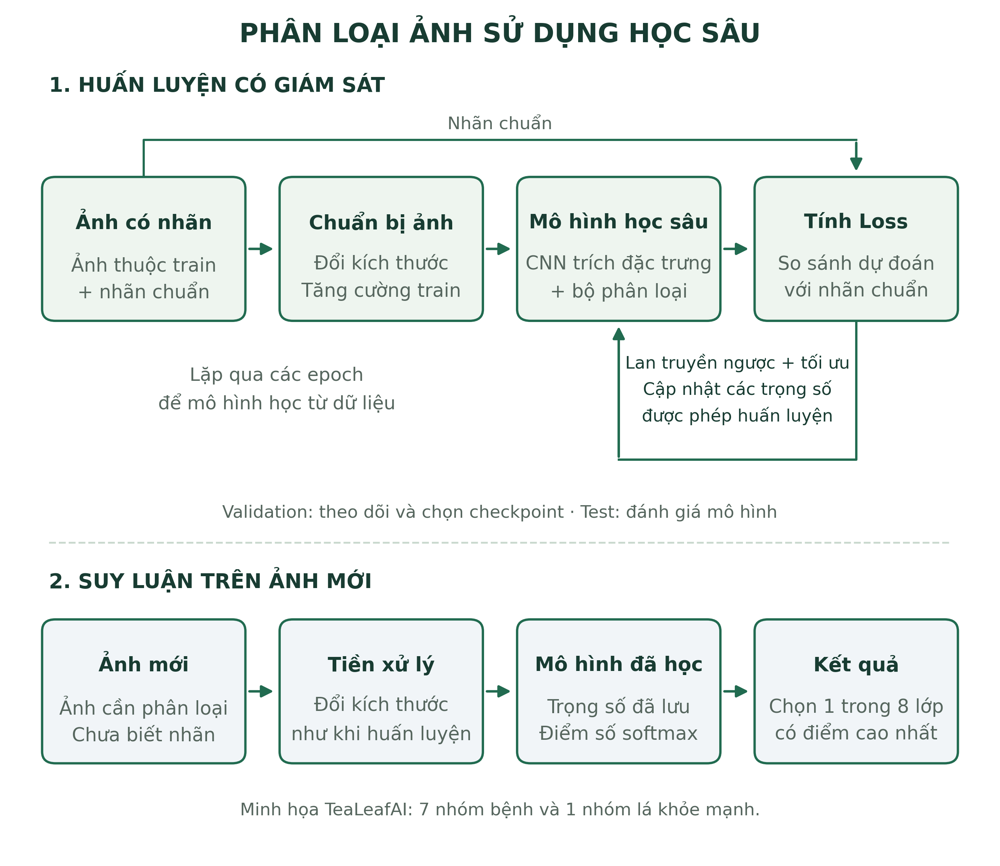

# Phân loại ảnh sử dụng học sâu

**Vị trí chèn:** mục 1.4.3.

**Chú thích:** Phân loại ảnh sử dụng học sâu trong bài toán nhận diện bệnh lá chè.

Nguồn: Tác giả xây dựng. Sơ đồ minh họa nguyên lý học có giám sát; không biểu diễn các trọng số hoặc số liệu thực nghiệm.

PNG 300 dpi để chèn Word; SVG/PDF là bản vector. Hai luồng tách biệt quá trình huấn luyện và suy luận.

## Đặc điểm hình ảnh của lá chè bị bệnh — mục 1.3.3

[Xem hình, nguồn ảnh và chú thích](dac-diem-hinh-anh-la-che-bi-benh.md). Hình gồm ba ảnh thật minh họa đốm lá, vùng biến màu và mảng mô nâu có biểu hiện khô; không gán tác nhân bệnh chỉ từ hình thái.
