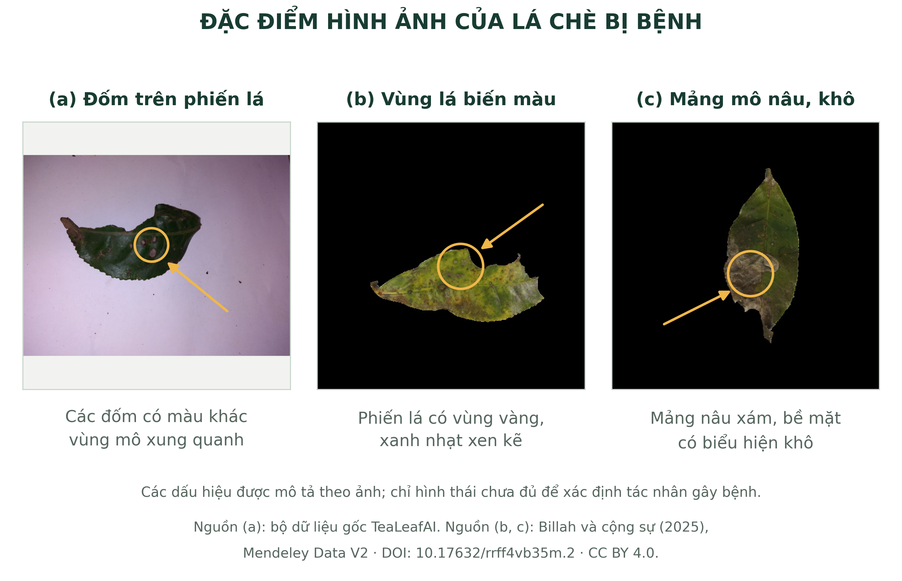

# Đặc điểm hình ảnh của lá chè bị bệnh

**Vị trí chèn:** mục 1.3.3.

**Chú thích:** Một số đặc điểm hình ảnh quan sát trên lá chè trong bộ dữ liệu bệnh.

Nguồn: (a) bộ dữ liệu gốc TeaLeafAI; (b, c) Billah, Sagor, Sultana và Uddin (2025), Real-Life Dataset of Tea Plant Leaf Disease Classification, Mendeley Data V2, DOI: 10.17632/rrff4vb35m.2, giấy phép CC BY 4.0.

Màu ảnh và nội dung lá được giữ theo ảnh nguồn; vòng tròn và mũi tên chỉ vùng minh họa. Các biểu hiện được mô tả qua quan sát ảnh, không khẳng định tác nhân gây bệnh. Không dùng phần mép lá bị khuyết để kết luận bệnh vì tổn thương đó cũng có thể do nguyên nhân khác.

PNG 300 dpi; có bản SVG/PDF.
