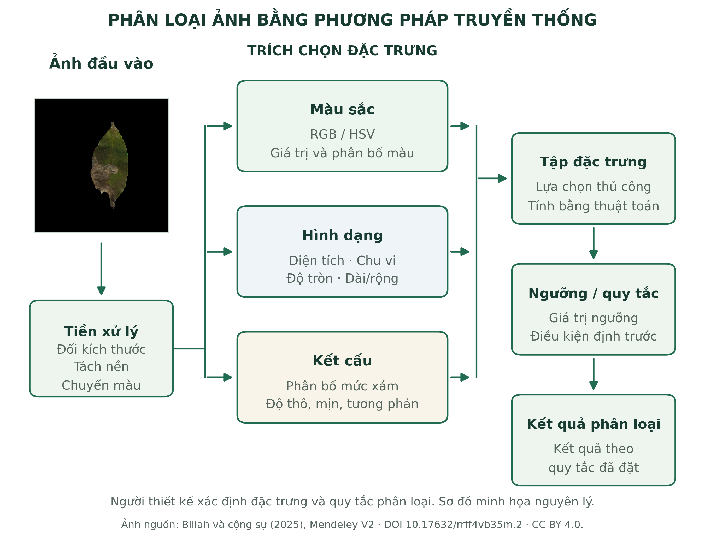

# Phân loại ảnh bằng phương pháp truyền thống

**Vị trí chèn:** mục 1.4.1.

**Chú thích:** Quy trình phân loại ảnh lá chè bằng đặc trưng thủ công và quy tắc định trước.

Nguồn: Tác giả xây dựng sơ đồ. Ảnh lá chè trích từ Billah, Sagor, Sultana và Uddin (2025), Real-Life Dataset of Tea Plant Leaf Disease Classification, Mendeley Data V2, DOI: 10.17632/rrff4vb35m.2, CC BY 4.0.

Chèn vào mục 1.4.1. Phân loại ảnh bằng phương pháp truyền thống. Sơ đồ mô tả nguyên lý, không biểu diễn kết quả chẩn đoán hoặc độ chính xác đã đo. Ngưỡng màu chỉ xác định vùng thỏa điều kiện màu; không tự xác nhận tác nhân gây bệnh.

PNG 300 dpi; có bản SVG/PDF.
