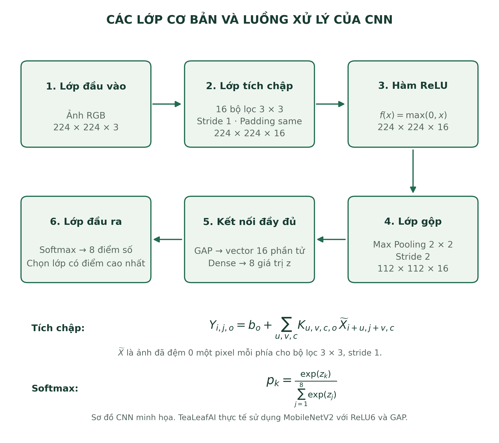
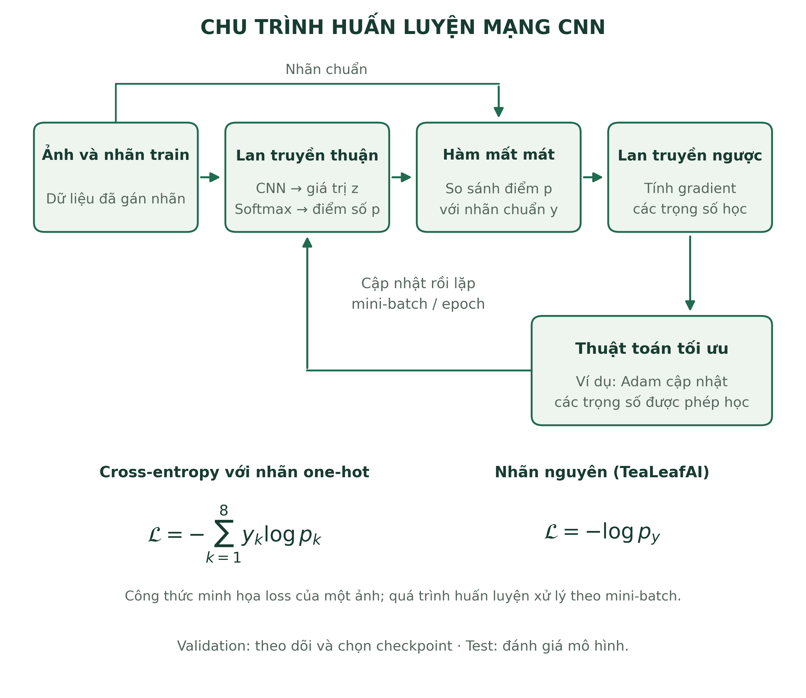

# Các lớp và quá trình huấn luyện CNN

Vị trí chèn: mục 2.3.2. Cấu trúc và nguyên lý hoạt động của CNN trong phân loại ảnh.

## Các lớp cơ bản và luồng xử lý của một CNN minh họa.

Đọc từ trái sang phải ở hàng trên, xuống lớp gộp rồi từ phải sang trái. Các kích thước là ví dụ lý thuyết: Conv 3 × 3, 16 bộ lọc, stride 1, padding same giữ 224 × 224; Max pooling 2 × 2 stride 2 giảm còn 112 × 112. GAP lấy trung bình toàn cục tạo vector 16 phần tử trước Dense 8. Đây là sơ đồ giải thích nguyên lý, không phải kiến trúc MobileNetV2 thực tế. Công thức tích chập dùng ảnh đã đệm, theo phép nhân–cộng thường dùng trong CNN.

## Chu trình huấn luyện CNN bằng lan truyền thuận, tính loss, lan truyền ngược và cập nhật trọng số.

Lan truyền ngược tính gradient; thuật toán tối ưu như Adam dùng gradient để cập nhật các tham số được phép huấn luyện. Nhãn chuẩn và điểm dự đoán cùng được dùng để tính loss. Công thức bên trái áp dụng cho nhãn one-hot; bên phải là dạng tương đương với nhãn nguyên, phù hợp Sparse Categorical Crossentropy trong TeaLeafAI. Điểm softmax không phải Accuracy của mô hình. Validation và test không tham gia cập nhật gradient.

Nguồn: Tác giả xây dựng theo nguyên lý CNN; đối chiếu định dạng nhãn và hàm mất mát trong mã huấn luyện TeaLeafAI.

PNG 300 dpi; có SVG/PDF. Các sơ đồ minh họa lý thuyết, không phải số liệu thực nghiệm.
