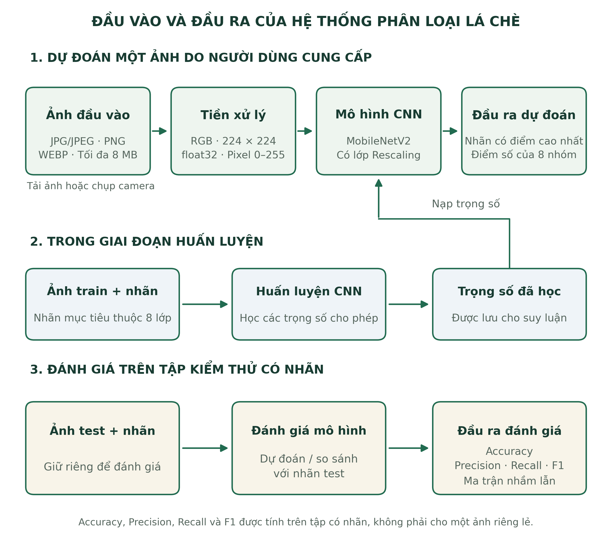

# Đầu vào và đầu ra của hệ thống

**Vị trí chèn:** mục 2.1.3.

**Chú thích:** Sơ đồ đầu vào và đầu ra của hệ thống phân loại bệnh lá chè trong dự đoán, huấn luyện và đánh giá.

Nguồn: Tác giả xây dựng từ frontend/src/api.js, frontend/src/image-preprocessing.js và các chương trình huấn luyện, đánh giá của TeaLeafAI.

Chèn tại mục 2.1.3. Đầu vào, đầu ra và yêu cầu hệ thống. Người dùng cung cấp ảnh khi dự đoán; nhãn chuẩn được dùng trong huấn luyện và đánh giá. Rescaling nằm bên trong mô hình, nên đầu vào được giữ trong khoảng 0–255. Điểm dự đoán của từng nhóm không đồng nhất với Accuracy. Các chỉ số và ma trận nhầm lẫn là kết quả đánh giá trên một tập ảnh có nhãn. Kết quả chỉ hỗ trợ nhận diện, cần đối chiếu với tình trạng thực tế của cây.

PNG 300 dpi; có SVG/PDF.
