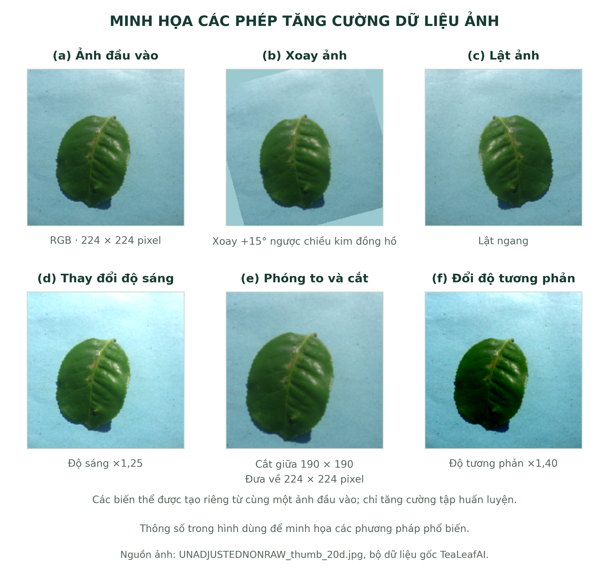

# Minh họa các phép tăng cường dữ liệu

**Vị trí chèn:** mục 2.2.5. Tăng cường dữ liệu ảnh.

**Chú thích:** Minh họa các phép tăng cường dữ liệu ảnh lá chè: xoay, lật, thay đổi độ sáng, phóng to/cắt và điều chỉnh độ tương phản.

Nguồn: Tác giả tạo các biến thể bằng Pillow từ ảnh UNADJUSTEDNONRAW_thumb_20d.jpg trong bộ dữ liệu gốc TeaLeafAI.

Các phép biến đổi được áp dụng độc lập lên cùng ảnh RGB đầu vào 224 × 224 pixel. Cắt giữa lấy vùng 190 × 190 pixel, tương đương khoảng 85% mỗi chiều, rồi đưa về 224 × 224 pixel. Hình minh họa các phương pháp phổ biến; phép cắt/phóng to và các hệ số minh họa không phải toàn bộ cấu hình huấn luyện thực tế. Trong lần huấn luyện hiện tại, dự án áp dụng xoay, lật, thay đổi độ sáng và tương phản cho train; không tăng cường validation/test.

PNG 300 dpi; có SVG/PDF.
