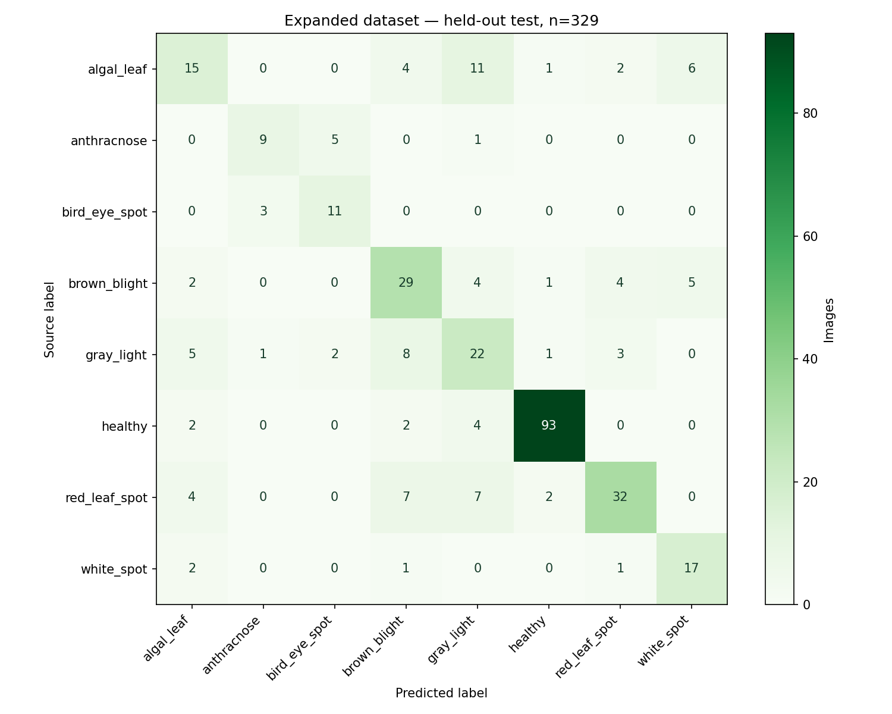
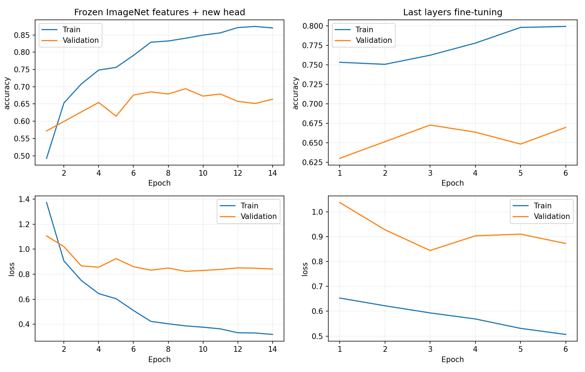

# Kết quả huấn luyện bộ dữ liệu mở rộng

## Dữ liệu và bộ chia

Tổng cộng **2.197 ảnh**, trong đó **673 ảnh lá khỏe**, nhiều hơn từng lớp bệnh. Dữ liệu gốc được giữ nguyên; ảnh trùng nhãn mâu thuẫn được loại khỏi lần huấn luyện.

| Lớp | Tổng | Train | Validation | Test |
| --- | ---: | ---: | ---: | ---: |
| algal_leaf | 265 | 185 | 41 | 39 |
| anthracnose | 99 | 69 | 15 | 15 |
| bird_eye_spot | 99 | 70 | 15 | 14 |
| brown_blight | 305 | 216 | 44 | 45 |
| gray_light | 281 | 197 | 42 | 42 |
| healthy | 673 | 472 | 100 | 101 |
| red_leaf_spot | 333 | 232 | 49 | 52 |
| white_spot | 142 | 100 | 21 | 21 |

Tỷ lệ thực tế 70,14% / 14,88% / 14,97%, do giữ ảnh gần trùng cùng nhóm. Có 1.541 ảnh train, 327 validation và 329 test. Không tăng cường validation/test. Nguồn và giấy phép: [TRAINING_DATA.md](../docs/TRAINING_DATA.md).

## Cách huấn luyện

1. Backbone MobileNetV2 lấy trọng số ImageNet, đóng băng và huấn luyện bộ phân loại mới trên đặc trưng đã lưu. Hai biến thể tăng cường chỉ áp dụng ở train.
2. Giai đoạn đầu chạy 14 epoch và dừng sớm, lấy checkpoint theo validation loss. Sau đó tinh chỉnh 30 lớp cuối (BatchNormalization đóng băng) tối đa 6 epoch, chọn checkpoint theo validation loss.
3. Trọng số lớp cân bằng đóng góp khi healthy có nhiều ảnh hơn. Test không tham gia cập nhật gradient.

## Kết quả test nội bộ

- Accuracy: **69.30%** trên 329 ảnh.
- Balanced accuracy: **66.05%**.
- Macro F1: **0.6453**.
- Weighted F1: **0.6933**.

| Lớp | Precision | Recall | F1 | Support |
| --- | ---: | ---: | ---: | ---: |
| algal_leaf | 0.500 | 0.385 | 0.435 | 39 |
| anthracnose | 0.692 | 0.600 | 0.643 | 15 |
| bird_eye_spot | 0.611 | 0.786 | 0.688 | 14 |
| brown_blight | 0.569 | 0.644 | 0.604 | 45 |
| gray_light | 0.449 | 0.524 | 0.484 | 42 |
| healthy | 0.949 | 0.921 | 0.935 | 101 |
| red_leaf_spot | 0.762 | 0.615 | 0.681 | 52 |
| white_spot | 0.607 | 0.810 | 0.694 | 21 |

## Giới hạn

- Đây là đánh giá nội bộ trên ảnh từ cùng các kho nguồn, chưa phải tập ảnh thực địa Việt Nam độc lập.
- Có đánh giá sơ bộ head trên cùng phân vùng test trước tinh chỉnh; checkpoint cuối chọn bằng validation loss. Vì vậy không coi đây là kiểm định bên ngoài.
- Chia nhóm bằng hash giảm trùng ảnh, nhưng chưa có định danh đầy đủ theo cây/lá/phiên chụp của tất cả nguồn.
- Không so sánh trực tiếp với báo cáo cũ: nguồn dữ liệu và cách chia đã thay đổi. Thêm ảnh không tự bảo đảm tăng độ chính xác.
- Các nhãn kế thừa nguồn công khai, chưa được nhóm dự án giám định lại toàn bộ tác nhân bệnh.

## Bản dùng trên web

- Model version: `mobilenetv2-expanded-20261117`.
- ONNX SHA-256: `b0ab25d82c74a52882e87c4d0d0fb3d7120ab4c7834ffe36d1a1e4e8990d32ea`.
- So sánh Keras/ONNX: 9 mẫu, sai số tối đa `8.17e-06`, top-1 trùng khớp.
- Đầu vào RGB float32 0–255, 224×224. Rescaling nằm trong mô hình; không chuẩn hóa hai lần.

Xem số liệu máy đọc được tại [evaluation.json](evaluation.json), manifest dữ liệu và nhật ký loại ảnh tại thư mục reports.
