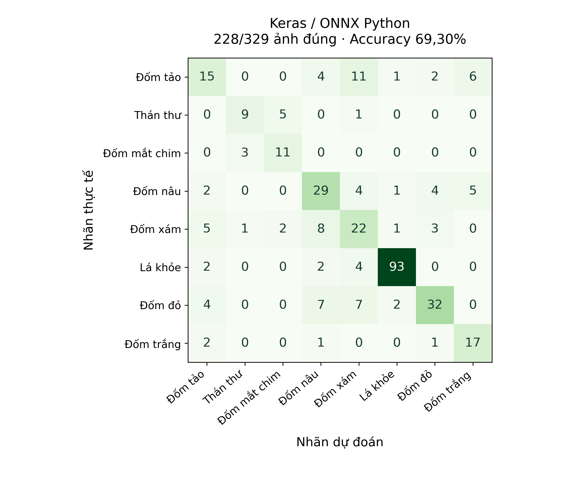
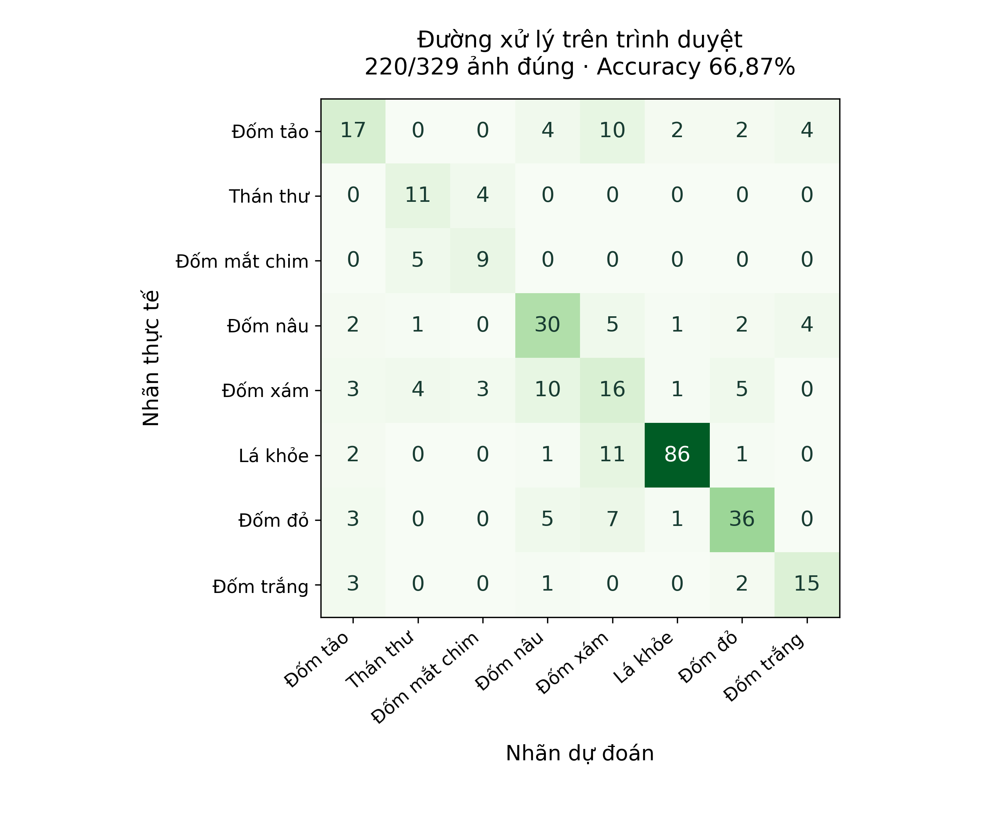

# Đánh giá lại mô hình TeaLeafAI — 18/11/2026

Đánh giá lại trên tập kiểm thử gồm 329 ảnh cho thấy mô hình Keras và ONNX trên Python phân loại đúng 228 ảnh, đạt Accuracy 69,30%. Khi chạy đúng đường xử lý ảnh của website trên trình duyệt, hệ thống phân loại đúng 220 ảnh, đạt Accuracy 66,87%. Đây là kết quả đánh giá nội bộ, chưa phải kiểm định thực địa độc lập.

| Chỉ số | Keras / ONNX Python | Trình duyệt |
| --- | ---: | ---: |
| Số ảnh kiểm thử | 329 | 329 |
| Dự đoán đúng | 228 | 220 |
| Dự đoán sai | 101 | 109 |
| Accuracy | 69,30% | 66,87% |
| Precision (macro) | 64,24% | 61,44% |
| Recall (macro) | 66,05% | 63,97% |
| F1-score (macro) | 64,53% | 62,23% |
| F1-score (weighted) | 69,33% | 67,45% |

## Quy trình và đối chiếu

- Giữ nguyên mô hình, nhãn, ảnh và bộ chia train/validation/test. Kiểm tra SHA-256 của toàn bộ 329 ảnh test, thứ tự 8 lớp và việc các nhóm ảnh gần trùng không xuất hiện ở nhiều tập. Không huấn luyện lại hoặc chọn checkpoint bằng kết quả lần kiểm tra này.
- Keras/ONNX Python: ảnh RGB JPEG đã chuẩn bị, đổi kích thước bằng Pillow bilinear về 224 × 224; đầu vào float32 có pixel 0–255. Lớp Rescaling đã nằm trong mô hình.
- Trình duyệt: chạy trực tiếp diagnose() và readImagePixels() của website bằng Chromium 156.0.8078.79; đọc ảnh, đổi kích thước bằng Canvas và suy luận bằng ONNX Runtime Web/WASM. Không gửi ảnh lên API. SHA-256 mô hình trùng manifest trên website đang triển khai.
- Keras và ONNX Python khớp top-1 ở cả 329 ảnh; sai số xác suất tối đa 1.18e-05. Hai đường tiền xử lý đổi nhãn ở 39 ảnh. Với 10 ảnh khác nhãn được kiểm tra thêm, CPU và WASM khớp khi nhận cùng điểm ảnh Canvas; sai số xác suất tối đa 3.22e-06. Kết quả này xác nhận ảnh hưởng của tiền xử lý ở 10 mẫu được đối chiếu.

## Chi tiết từng lớp — Keras / ONNX Python

| Lớp | Precision | Recall | F1 | Số ảnh |
| --- | ---: | ---: | ---: | ---: |
| algal_leaf | 50,00% | 38,46% | 43,48% | 39 |
| anthracnose | 69,23% | 60,00% | 64,29% | 15 |
| bird_eye_spot | 61,11% | 78,57% | 68,75% | 14 |
| brown_blight | 56,86% | 64,44% | 60,42% | 45 |
| gray_light | 44,90% | 52,38% | 48,35% | 42 |
| healthy | 94,90% | 92,08% | 93,47% | 101 |
| red_leaf_spot | 76,19% | 61,54% | 68,09% | 52 |
| white_spot | 60,71% | 80,95% | 69,39% | 21 |



## Chi tiết từng lớp — Trình duyệt

| Lớp | Precision | Recall | F1 | Số ảnh |
| --- | ---: | ---: | ---: | ---: |
| algal_leaf | 56,67% | 43,59% | 49,28% | 39 |
| anthracnose | 52,38% | 73,33% | 61,11% | 15 |
| bird_eye_spot | 56,25% | 64,29% | 60,00% | 14 |
| brown_blight | 58,82% | 66,67% | 62,50% | 45 |
| gray_light | 32,65% | 38,10% | 35,16% | 42 |
| healthy | 94,51% | 85,15% | 89,58% | 101 |
| red_leaf_spot | 75,00% | 69,23% | 72,00% | 52 |
| white_spot | 65,22% | 71,43% | 68,18% | 21 |



## Phạm vi sử dụng và số liệu trong báo cáo

- Tập test đã được sử dụng trong quá trình phát triển trước đây; chạy lại không tạo thành một kiểm định độc lập mới. Ảnh cùng nguồn và thiếu định danh đầy đủ theo cây/phiên chụp vẫn giới hạn khả năng khái quát.
- Nhãn được kế thừa bộ dữ liệu nguồn, chưa được chuyên gia giám định lại toàn bộ tác nhân bệnh. Điểm dự đoán của một ảnh không phải Accuracy của mô hình.
- Mức 94,5% trên 400 ảnh trong file Word chưa được tái lập với checkpoint và bộ dữ liệu hiện tại. Nếu dùng mô hình hiện tại, phải ghi rõ 329 ảnh và phân biệt kết quả Python 69,30% với kết quả đường xử lý trên trình duyệt 66,87%.
- Các số 96,4%/94,2% và bảng so sánh ResNet50/VGG16 trong file Word không được xác nhận bởi lần đánh giá này; cần đối chiếu nhật ký hoặc cung cấp mô hình, dữ liệu và mã đánh giá tương ứng.

Macro là trung bình đều giữa 8 lớp; weighted có trọng số theo số ảnh mỗi lớp. Healthy có 101/329 ảnh test nên cần xem cả macro F1.

## Tái tạo

Dùng môi trường TensorFlow/ONNX và bộ dữ liệu đã chia của dự án. Không chạy prepare_dataset.py trước lần đánh giá này.

```bash
python training/reevaluate_expanded.py
# Mở một terminal khác: cd frontend && npm run dev -- --host 127.0.0.1 --port 5179 --strictPort
# Với Playwright và Chromium đã cài:
node frontend/tests/reevaluate-browser.mjs
```

Model version: `mobilenetv2-expanded-20261117`.
ONNX SHA-256: `b0ab25d82c74a52882e87c4d0d0fb3d7120ab4c7834ffe36d1a1e4e8990d32ea`.
Dataset manifest SHA-256: `585cabd7be1741675fa5bed31c14116b9f72f7eca11d40610313ddb15cd48707`.

Dữ liệu máy đọc được: native.json, browser-metrics.json, browser-predictions.json, pixel-parity.json và các CSV.
